# Ledger

> **中文简介**：Ledger 是一个安静的个人进度账本——拆解目标、每天打卡习惯、看本周一览和年度热力图，每天可以记一句笔记。
> 纯静态 PWA（原生 JavaScript，无构建步骤），**离线优先**：数据先存本机，登录后通过 Supabase（Auth + Postgres + RLS）自动同步，
> 用版本号（rev）乐观锁处理多设备冲突。有田园 / 电玩 / 星夜三套像素主题和原来的简约主题，支持中英双语、可安装到主屏幕，另有 Capacitor 打包的安卓 App（含每天提醒）。
> 详细的中文配置与部署说明见 [docs/SETUP.zh-CN.md](docs/SETUP.zh-CN.md)。

**A quiet, offline-first progress ledger for goals and daily habits.**
Vanilla-JS PWA · Supabase Auth + Postgres (RLS) · revision-based sync · Capacitor Android · 中文 / English

**Live:** <https://ledger-ethan.netlify.app> · **Android APK:** [GitHub Releases](https://github.com/EthanLai-9du/ledger/releases/latest) or <https://ledger-ethan.netlify.app/ledger.apk> (debug-signed, sideload) · **Version:** v12

<p>
  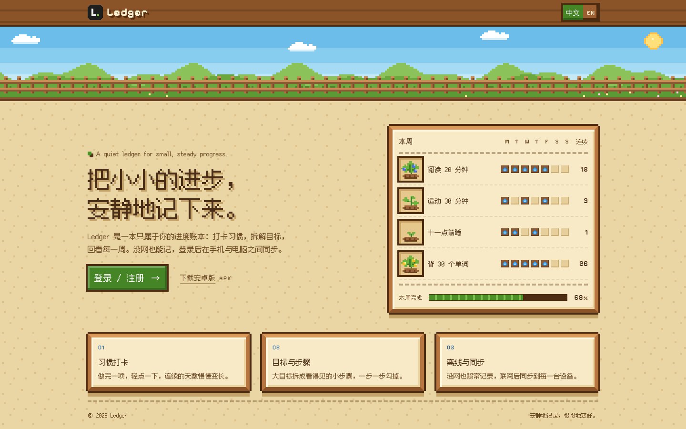
  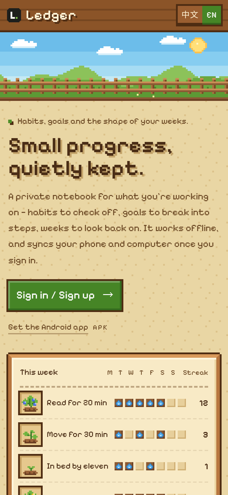
</p>

**Four tabs (v12)**

<p>
  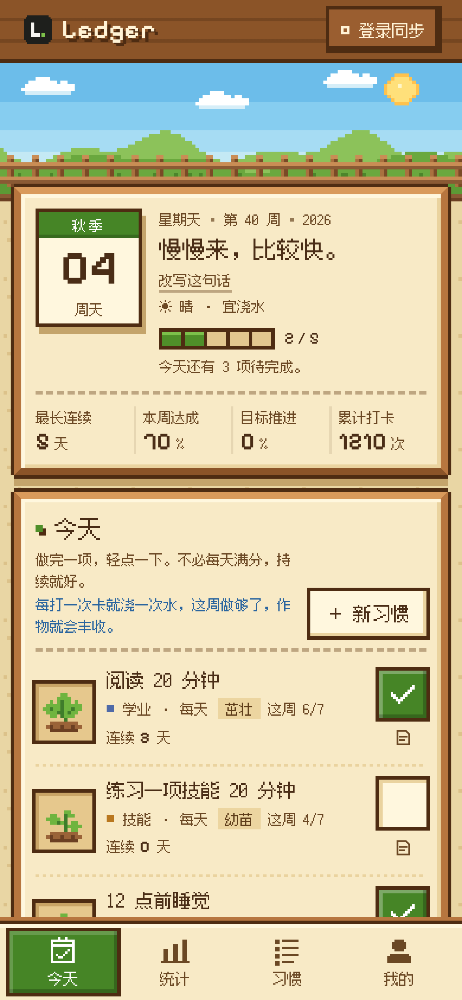
  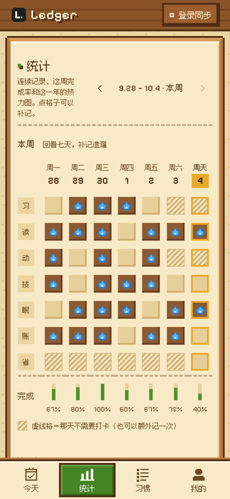
  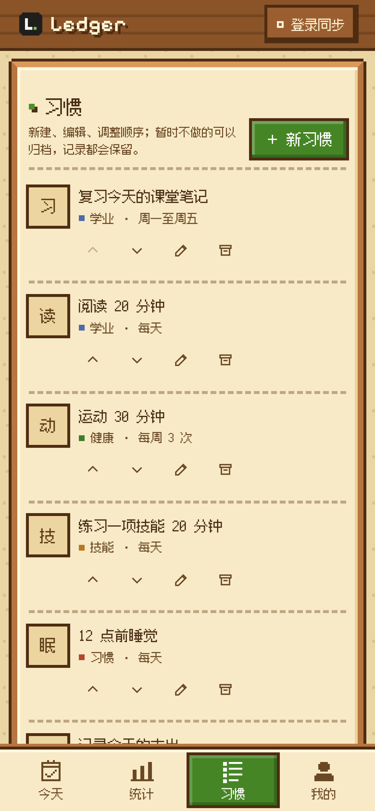
  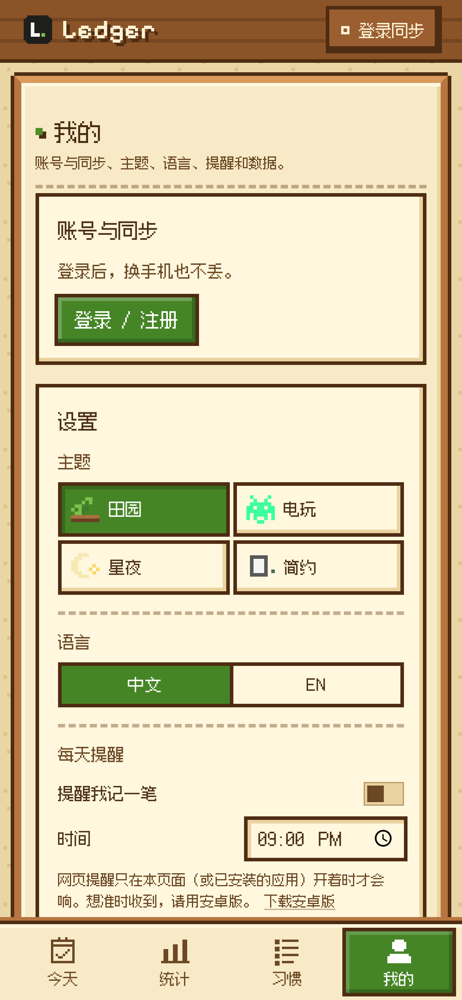
</p>

**Onboarding (v12)**

<p>
  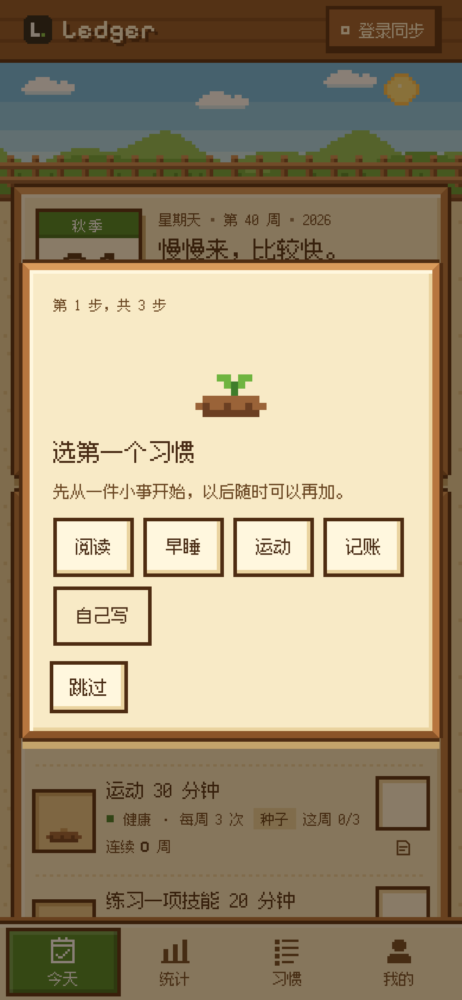
  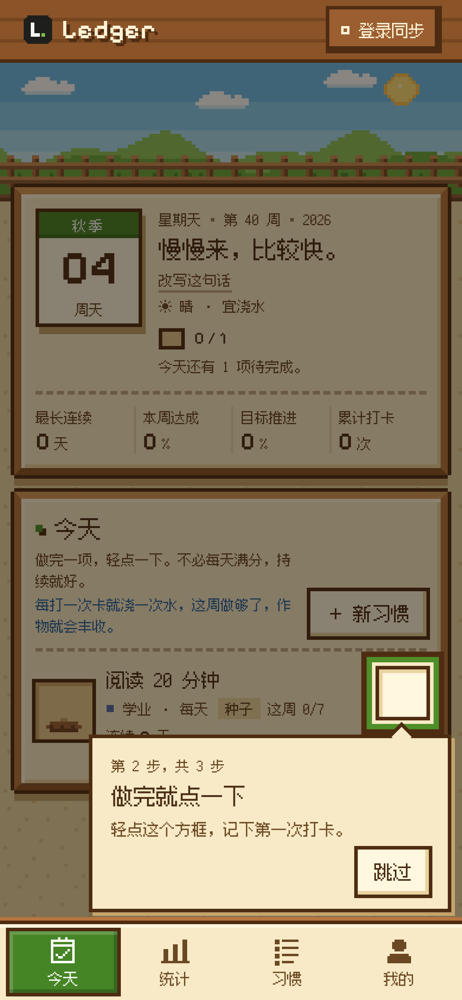
  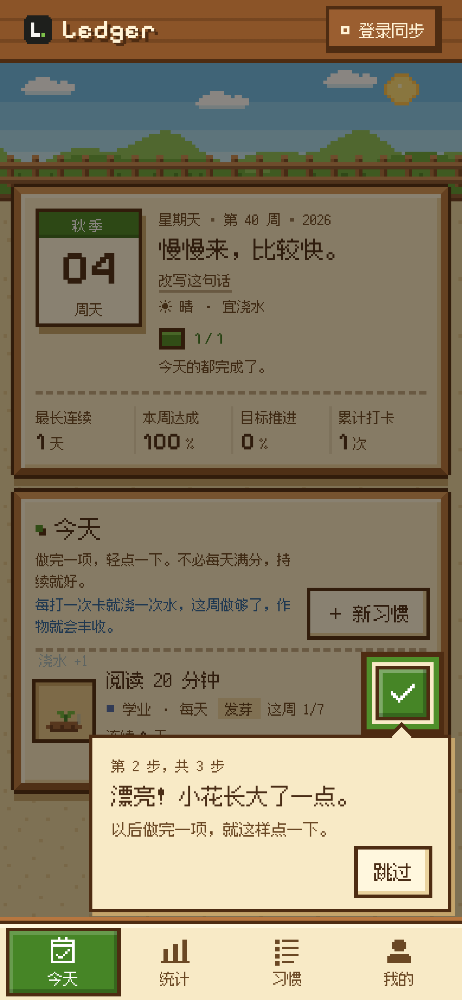
  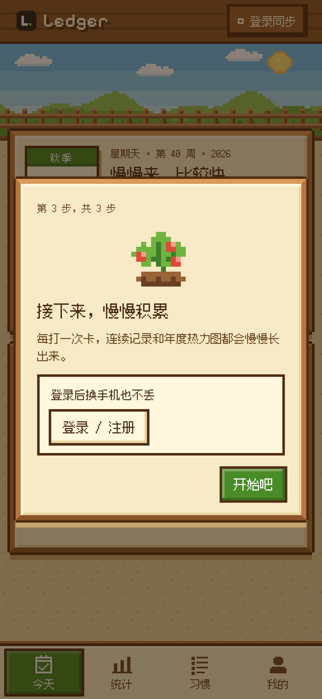
  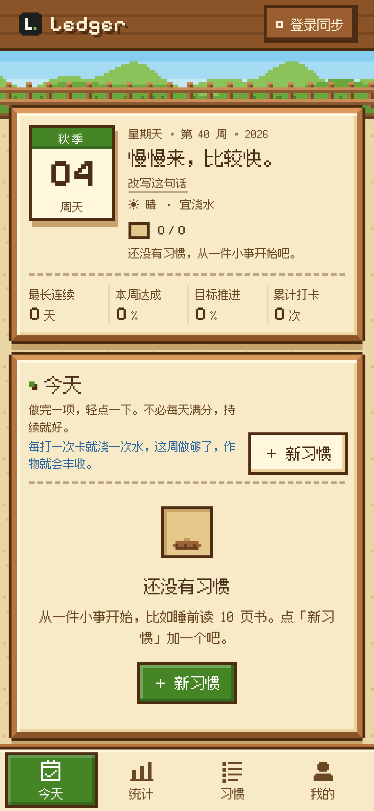
</p>

**Pixel themes: Farm · Arcade · Night · Minimal**

<p>
  
  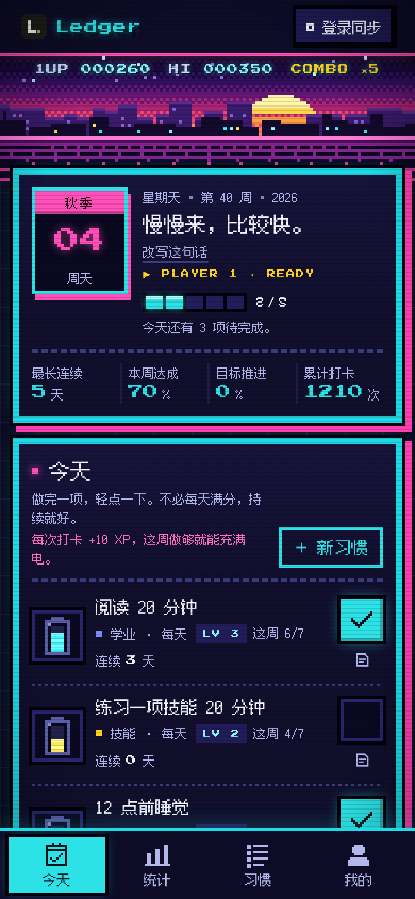
  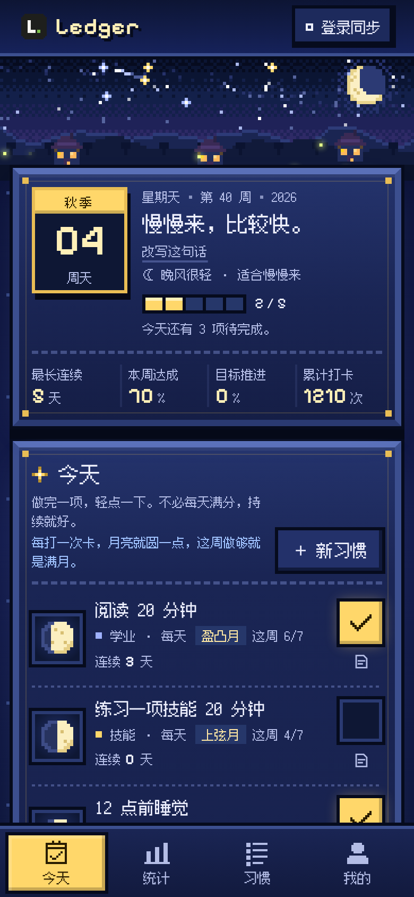
  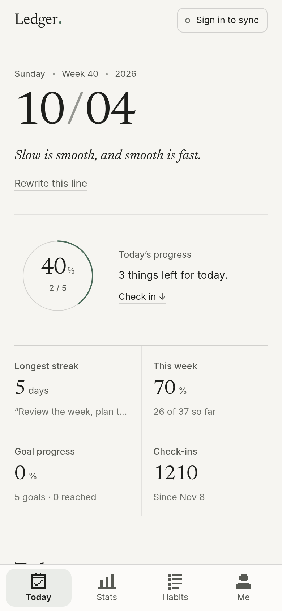
</p>

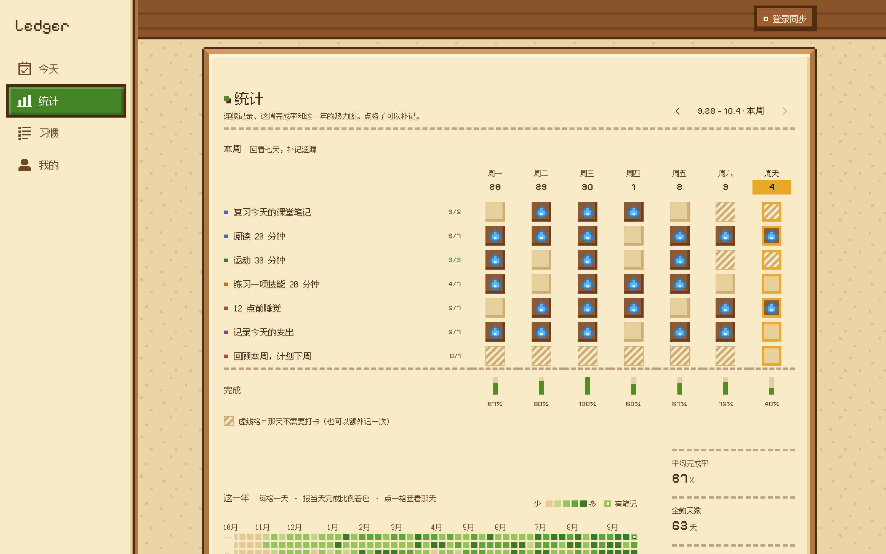

---

## What it is

Ledger is a small personal tool for keeping track of steady progress: break a goal into steps, check off daily habits, and see the
week and the last six months at a glance. It is deliberately calm — warm paper, graphite ink and a single ink-green accent that
only ever means "done".

It runs entirely in the browser with no backend of its own. Data is written to the device first, so the app opens and works
offline; signing in (email + password or magic link) syncs one JSON document per user to Supabase. The same code ships as an
installable PWA and, wrapped with Capacitor, as an Android app.

## Features

- **Pixel themes (v10)** — four skins: 田园 Farm (default), 电玩 Arcade, 星夜 Night and 简约 Minimal (the original ink-grey look). Each one themes every screen (landing, sign-in, tracker, week, year, settings, dialogs, toasts, empty states, loading screen) and has its own check-in metaphor driven by the habit's real weekly count: crops grow from 种子 to 丰收 as you water them, a battery charges with +XP and coins, or the moon waxes to full with stars.
- **Four tabs (v12)** — 今天 Today (date card, today's progress and check-ins), 统计 Stats (year heatmap, streaks, weekly grid, per-habit stats, notes), 习惯 Habits (create, edit, frequency, reorder, archive / restore, plus goals) and 我的 Me (account and sync, theme, language, reminder, export / import, replay the guide, about). Phones get a pixel bottom bar, desktops a left sidebar; hash routes (`#/today`, `#/stats`, `#/habits`, `#/me`) switch without a reload, work offline and support back / forward. The day's note opens from the note button on each habit row.
- **Light onboarding (v12)** — first open shows three skippable steps: pick one first habit (阅读 / 早睡 / 运动 / 记账 or your own; brand-new users start with just that one habit), tap its checkbox under a spotlight ("做完就点一下") and watch it grow, then a closing card about streaks, the heatmap and logging in to keep data across phones. Existing users with data never see it; the done flag syncs (`prefs.onboarded`) and is mirrored locally. Settings → 重新看新手指引 replays it. No habits → a friendly empty state pointing to 新习惯.
- **Guest mode (v11)** — Ledger works without an account; while signed out, a dismissible-per-session banner explains that data stays on this device until you log in.
- **Check-ins, weekly grid, goals** — habit check-ins, a weekly grid, goals with steps and due dates.
- **Flexible frequency** — per habit: 每天, 周一至周五, chosen weekdays, or N 次/周. Days a habit isn't due show as "not required" in the week view and never break a streak.
- **Streaks and stats** — current streak, longest streak and this week's completion per habit, kept low-key (days for scheduled habits, weeks for N-per-week habits).
- **Year heatmap** — a GitHub-style 53-week grid of daily completion, themed per skin; click (or arrow-key) a day to see what was done and its note.
- **One-line note** — an optional "今天做了什么" line per day, synced, browsable in the history list and from any heatmap day.
- **Export** — download everything as JSON (full backup, re-importable) or CSV (one row per day, a column per habit, plus the note; UTF-8 with BOM so Excel opens it cleanly), from Settings or the Data section.
- **Offline-first sync** — every change is saved locally at once, then pushed (debounced) to Supabase; retries with back-off when offline.
- **Conflict handling** — optimistic concurrency with a server-side revision counter; small divergences auto-resolve with an undo, real conflicts open a side-by-side comparison dialog.
- **Accounts** — Supabase Auth: sign up, password sign-in, magic link, password reset; or "use locally without an account".
- **Daily reminder** — Android: a repeating local notification at the chosen time. Web: an honest "only while the page is open" reminder (no push server).
- **Bilingual UI** — Chinese and English, switchable at runtime; separate motto per language; English starter template for English users.
- **Light / dark / system** for the Minimal skin, responsive from small phones to desktop, reduced-motion support.
- **Android app** — the same code wrapped with Capacitor 7, with a true local notification for the daily reminder; download the APK from [Releases](https://github.com/EthanLai-9du/ledger/releases/latest).
- **PWA** — installable, works offline via a service worker that never caches Supabase traffic.
- **Accessible** — keyboard-navigable dialogs and menus, visible focus, ARIA labelling; axe-core reports 0 violations across all screens, both languages and every skin (Minimal in light and dark).

## Tech stack

| Area | Choice |
|---|---|
| UI | Vanilla JavaScript (ES5-style IIFEs), semantic HTML, hand-written CSS with custom properties; no framework, no build step |
| Backend | [Supabase](https://supabase.com): Auth + Postgres, Row Level Security, a trigger-maintained `rev` column; free tier, no server of our own |
| Sync | Offline-first local store + debounced push, revision-based optimistic locking, conflict dialog |
| Offline | Service worker (versioned app-shell precache, network-first for HTML/config, cache-first for fonts) + Web App Manifest |
| Mobile | [Capacitor 7](https://capacitorjs.com) Android wrapper; `@capacitor/local-notifications`, status bar, splash screen |
| i18n | ~450-line dictionary keyed by the Chinese source string (gettext-style), runtime language switch, `<html lang>` kept in sync |
| Fonts | Self-hosted OFL subsets (Noto Serif SC, Newsreader, Inter) built with fontTools; Chinese serif split into `unicode-range` chunks |
| Testing | Playwright (Python) end-to-end suites with a mocked Supabase API, axe-core accessibility audit |

## Architecture

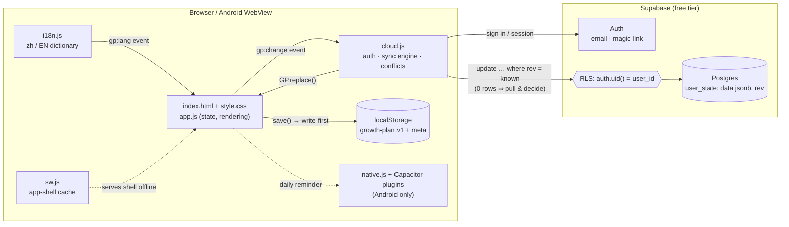

**Sync, in short:** each user has one row `user_state(user_id, data jsonb, rev, updated_at, device)`. A trigger bumps `rev` on
every update. The client pushes with `update … where user_id = me and rev = lastKnownRev`; if zero rows change, another device
wrote first, so the client pulls the cloud copy and decides: take whichever side changed, auto-pick the newer copy for small
differences (with an undo toast), or ask the user with a comparison dialog when both sides diverged meaningfully.

## Design decisions

- **One JSON document per user, not normalized tables.** The client model is already a single document (areas, habits, goals, log), validated and exported as a whole. Storing it as one `jsonb` row means no half-synced states ("habit synced, check-in didn't") and conflict resolution compares exactly one thing. A semester of data is tens of KB.
- **Revision counter over timestamps for writes.** Clocks on phones drift; a server-maintained `rev` makes "did someone else write?" exact. Timestamps are only used to *recommend* which copy is newer, and the user confirms when it matters.
- **No framework, no build.** The whole app is ~4k lines of readable source that deploys by copying a folder (Netlify drop, Vercel, `file://`). It keeps first load small and the Android `www/` a straight copy.
- **Security via RLS, not secrecy.** The browser only holds Supabase's publishable key (set in `config.js`); every policy checks `auth.uid() = user_id`, and `anon` has no grants.
- **Honest reminders.** Real background push on the web needs a push server, which this project intentionally doesn't run. The web toggle says plainly that it only fires while the page is open and points to the Android app, which schedules a true local notification.
- **Reminder settings stay on the device.** Notification permission is per device, and "remind me on my phone" shouldn't make a laptop tab pop up too, so the setting lives in localStorage instead of the synced document.
- **CJK font weight, handled with `unicode-range`.** A Chinese serif is large; the old single subset was 425 KB. Now a ~40 KB critical chunk holds only the glyphs used in serif headlines and is the only one preloaded; 3,800+ common characters (GB2312 level 1 ∪ top-3,500 by frequency) are split into 13 frequency-ordered chunks that the browser fetches only when a user's own text needs them. Chinese body text uses the system sans.
- **Chinese strings as i18n keys.** Static HTML stays readable in its source language; the English dictionary swaps text, ARIA labels and placeholders at runtime, and tests flag any missing key.
- **Skins vs. dark mode.** Farm is a light skin; Arcade and Night are dark by design, so the light/dark/system switch only exists for Minimal (it's hidden while a pixel skin is on). The skin is part of the synced document (`prefs.theme`) so it follows the account across devices, and is mirrored in localStorage so the first paint already has the right colours. The light/dark choice stays per device, like before. Existing users who never picked a skin get Farm.
- **Backward-compatible data model (v2).** Habits gain `freq` / `target` (old `days` lists are kept and mapped: all 7 → 每天, Mon–Fri → 周一至周五, anything else → chosen days); the document gains `notes` and `prefs`. Migration happens silently in `validate()`, is idempotent, and doesn't trigger a cloud write by itself. An older v9 client that opens a v10 row keeps notes and prefs but drops `freq`/`target`, so weekly habits fall back to "every day" there.
- **Pixel fonts split the same way.** Fusion Pixel 12px (Chinese), Pixelify Sans (Latin) and a renamed Press Start 2P subset (Arcade digits). A ~20 KB critical chunk covers every hanzi in the UI; 9 on-demand chunks cover the 3,500 most common characters for anything a user types. English mode loads only the Latin pixel font. Rare characters fall back to the system font.
- **A single accent colour (Minimal).** Ink green means "done" and nothing else; hierarchy comes from type weight and spacing.

## Run locally

```bash
git clone https://github.com/EthanLai-9du/ledger.git && cd ledger
python3 -m http.server 8765          # any static server works
open http://localhost:8765
```

Opening `index.html` directly (`file://`) also works in local-only mode; the service worker and magic-link redirects need http(s).

To enable cloud sync with your own Supabase project:

1. Run [`schema.sql`](schema.sql) in the Supabase SQL editor (creates `user_state`, the `rev` trigger and RLS policies; safe to re-run).
2. Put your project URL and **publishable (anon) key** in [`config.js`](config.js). Never use a `service_role` / secret key in the browser.
3. Add your site URL(s) to Authentication → URL Configuration → Redirect URLs.

Full step-by-step notes (in Chinese) are in [docs/SETUP.zh-CN.md](docs/SETUP.zh-CN.md).

## Deploy

The folder *is* the site — no build command.

- **Netlify:** drag the folder onto <https://app.netlify.com/drop>, or connect the repo with an empty build command and publish directory `.`. `_headers` keeps `sw.js` / `config.js` uncached.
- **Vercel:** import the repo with framework preset "Other" and no build command; `vercel.json` sets the same headers.
- **Android:** the Capacitor project lives in [`android-app/`](android-app). Its `www/` folder is generated: copy the site files into `android-app/www/` (keeping the committed `native.js` and the Android `cloud.js`, which differs by two Capacitor-specific lines, and adding `<script src="native.js" defer></script>` after the `cloud.js` tag in `index.html`), then:

  ```bash
  cd android-app
  npm i                                   # Capacitor 7 + plugins
  npx cap sync android
  cd android && ./gradlew assembleDebug   # needs JDK 21 + Android SDK
  ```

When releasing a new version, bump `VERSION` in `sw.js` so clients drop the old cache.

## Testing

Each suite is a standalone Playwright script that drives headless Chrome against a local server (`python3 -m http.server 8765`);
Supabase is mocked at the network layer, so no real accounts are touched.

| Suite | Covers |
|---|---|
| `tools/gp_test.py` | Core app: landing → auth → local mode, habits, goals, week, heatmap, dialogs, import/export, keyboard flows |
| `tools/gp_cloud_test.py` | Auth flows, push/pull, offline queue + back-off, revision conflicts, account switching, sign-out |
| `tools/gp_seed_test.py` | First-run templates and never overwriting existing local / cloud data |
| `tools/gp_pwa_test.py` | Manifest, icons, service worker precache, offline reload, Supabase never cached |
| `tools/gp_i18n_test.py` | zh / EN switching everywhere, no untranslated strings, `<html lang>`, banned-character copy rule |
| `tools/gp_menu_test.py` | Settings on the 我的 page (skins with arrow keys, light/dark for Minimal, language, desktop layout), per-language motto |
| `tools/gp_reminder_test.py` | Daily reminder: toggle, persistence, helper text, firing once at the chosen time, denied permission, unsupported `Notification`, and a mocked Capacitor plugin (permission, daily schedule, reschedule on time / language change, cancel) |
| `tools/gp_font_test.py` | Font chunks: Chinese landing loads only the critical chunk, typed text pulls exactly the needed chunks, English loads no CJK font, non-overlapping ranges, SW precache vs runtime cache |
| `tools/gp_v10_test.py` | v1 → v2 migration (no data loss, idempotent, no spurious push), frequency rules, streaks / longest / weekly rate, notes, year heatmap (keyboard, day card), JSON + CSV export, skin sync across devices |
| `tools/gp_v12_test.py` | Onboarding: fresh guest flow (1 habit only, spotlight, feedback, closing card), skip at every step, write-your-own, Esc, existing users skip, replay from settings, EN, reduced motion, 360 px in every theme, cloud flag sync, settings footer logo |
| `tools/gp_tabs_test.py` | Four tabs: hash routing without reload, back / forward, deep links, aria-current, focus to the tab heading, note from a habit row, reorder / archive / restore, 我的 contents, onboarding inside the tabs (starts on 今天, one toast at a time, sane first stats), EN, 360 px × every theme × zh/EN, desktop sidebar, offline deep link |
| `tools/gp_axe.py` | axe-core (WCAG 2 A/AA + best practices) on landing, auth, app, every tab (phone + desktop), the note dialog, the habit dialog, the three onboarding steps and the empty state × zh/EN × Farm / Arcade / Night / Minimal light / Minimal dark |

```bash
python3 -m http.server 8765 &
for t in tools/gp_*test.py; do python3 "$t"; done
python3 tools/gp_axe.py http://127.0.0.1:8765/
python3 tools/gp_firstload.py        # first-load byte budget for the Chinese landing page
```

Pixel fonts are rebuilt with `python3 tools/build_px_fonts.py`, icons with `python3 tools/make_icons.py`. Serif fonts are regenerated with `python3 tools/build_fonts.py` (fontTools + brotli; it rescans the UI text and rewrites the chunk CSS).

## Roadmap

- Field-level merge for the rare "both devices edited offline" case (e.g. union of check-ins) instead of choosing one copy.
- Supabase Realtime (or a pull on focus with ETags) so a second open device updates without a refresh.
- Web Push via a Supabase Edge Function for reliable reminders in the browser.
- Release-signed Android build on a store track; iOS wrapper.
- Simple trend charts per habit.
- Optional end-to-end encryption of the synced document.

## Project layout

```
index.html  style.css  pixel.css  skin.js  app.js  cloud.js  i18n.js  config.js  sw.js  manifest.webmanifest
# pixel.css = the three pixel skins; skin.js = sprites, scenes and check-in effects
schema.sql            # table, revision trigger, RLS policies
fonts/                # self-hosted OFL subsets + serif-sc.css / px-sc.css (unicode-range chunks), licences
icons/  vendor/       # PWA icons, bundled supabase-js
tools/                # font build, Playwright + axe test suites, screenshot scripts
docs/                 # Chinese setup guide; docs/screenshots/ for the README images
android-app/          # Capacitor 7 Android project (source + config only; www/ is generated)
```

## License

Code: [MIT](LICENSE) © 2026 Ethan Lai. Fonts are licensed under the SIL Open Font License 1.1 (see `fonts/LICENSES.md`); supabase-js is MIT (see `vendor/supabase-LICENSE`).
